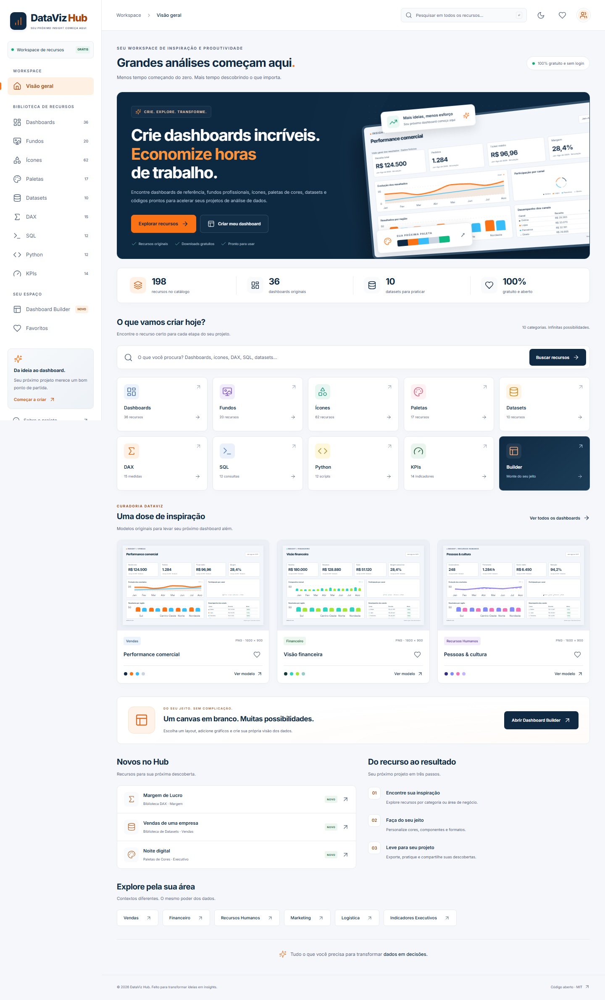

# DataViz Hub

**Recursos Inteligentes para Analistas de Dados**

Tudo o que você precisa para transformar dados em decisões.

Biblioteca gratuita, pública e sem login para economizar tempo na criação de dashboards e projetos de análise. Aplicação funcional em português brasileiro, com recursos originais, dados sintéticos, pesquisa, filtros, favoritos e um construtor visual que exporta arquivos reais.



## O que está disponível

| Biblioteca           |          Conteúdo inicial | Ações                                                                                                                    |
| -------------------- | ------------------------: | ------------------------------------------------------------------------------------------------------------------------ |
| Dashboards           |      36 modelos, 12 áreas | Gráficos reais, filtros de categoria/cor/tipo, prévia com filtro de período, PNG 1600 × 900, favoritos                   |
| Fundos para Power BI |       20 fundos originais | SVG gerado localmente, PNG em 1280 × 720, 1600 × 900 ou 1920 × 1080, copiar cores                                        |
| Ícones               | 62 ícones Lucide, 9 áreas | Cor e tamanho configuráveis, SVG, PNG transparente, copiar SVG/HEX, pacote ZIP                                           |
| Color Palette Studio |                17 paletas | Editar, gerar combinações, copiar HEX/RGB, salvar combinações nos favoritos, PNG, JSON e tema de cores Power BI          |
| Dataset Center       |     10 bases × 600 linhas | CSV e XLSX reais, dicionário, prévia lida com PapaParse, KPIs, sugestões de análise, exercícios de limpeza identificados |
| DAX                  |                15 medidas | Objetivo, fórmula, explicação, dependências e exemplos                                                                   |
| SQL                  |              12 consultas | SQL Server e MySQL identificados, destaque de sintaxe, explicação e cópia                                                |
| Python               |                12 scripts | Bibliotecas, entradas, resultados esperados e cópia                                                                      |
| KPI Explorer         |            14 indicadores | Significado, fórmula, exemplo, interpretação e gráfico ilustrativo                                                       |

O catálogo inicial contém **198 recursos**. Os contadores são calculados a partir dos JSON locais; não representam usuários nem downloads. Combinações pessoais de cores ficam no navegador e são adicionadas às páginas Paletas, Favoritos e Pesquisa.

A Home mostra os dashboards que você mais abriu neste navegador, assim que houver visualizações. A seção de curadoria permanece disponível desde a primeira visita.

O **Dashboard Builder** oferece três templates e canvas em branco, dez tipos de componente, layout de 2/3/4 colunas, três resoluções, paletas, títulos, valores de KPI, largura e controles de posição. Inclui remoção, desfazer (20 ações), visualização, rascunho local automático, PNG na resolução escolhida e importação/exportação de projeto JSON.

As páginas internas têm navegação e breadcrumbs. As prévias fecham com Escape e mantêm o foco dentro do modal. O menu mobile abre por um botão no topo. A busca global está na Home e no cabeçalho, com um atalho de busca em telas estreitas.

Na galeria, abra a prévia de um dashboard e selecione Jan–Ago, Jan–Abr ou Mai–Ago de 2025. Os gráficos, indicadores e a tabela mostram os dados demonstrativos do período selecionado. O PNG captura essa mesma visão.

Clique numa barra em **Resultados por região** ou use o seletor **Região**. O filtro regional se combina com o período, atualiza os indicadores e a tabela de canais e aparece no PNG. Clique novamente na região ativa ou use **Limpar região** para voltar ao total.

Clique numa fatia em **Participação por canal** ou use o seletor **Canal**. Os indicadores e a tabela mostram o cruzamento de canal, região e período. Clique novamente na fatia ativa ou use **Limpar canal** para restaurar os canais da região e do período selecionados.

Clique no mês no gráfico de evolução ou use o seletor **Mês** para restringir os indicadores e a tabela sem perder a região e o canal. O gráfico mantém visíveis os meses do período para facilitar a troca. **Limpar mês** restaura o período completo, e mudar para um período que não contém o mês ativo limpa só o mês.

**Limpar todos os filtros** restaura Jan–Ago e remove as seleções de região, canal e mês em um clique.

## Tecnologias e arquitetura

- React 19, Vite 7 e JavaScript com módulos ES.
- Tailwind CSS 4 via plugin Vite, com tokens e estilos de componentes em CSS.
- React Router, Recharts e Lucide React.
- html-to-image para PNG de composições React; Canvas para converter SVG em PNG.
- JSZip, PapaParse e Prism para downloads e recursos técnicos.
- Python + Pandas + openpyxl para produzir arquivos CSV/XLSX estáticos, sem APIs e sem banco de dados.
- Vitest, React Testing Library e Playwright (Chromium, desktop e emulação mobile).
- Inter empacotada localmente; sem fontes, imagens ou serviços remotos necessários em tempo de uso.

`src/data/catalog.js` reúne os JSON e o índice de metadados. Os componentes reutilizam as mesmas funções de busca, exportação, favoritos e validação. As rotas de bibliotecas e builder são carregadas sob demanda. O registro Lucide inclui apenas os ícones utilizados, para evitar empacotar toda a biblioteca.

## Requisitos

- **Node.js 24 LTS com npm**. Vite também aceita Node 20.19+ ou 22.12+; Node 24 é usado na CI.
- Python 3.11+ somente para regenerar ou validar datasets. Os downloads já estão no repositório.
- Chromium instalado pelo Playwright somente para testes end-to-end.

## Instalação e execução

Na pasta do projeto:

```bash
npm install
npm run dev
```

Abra o endereço informado pelo Vite (normalmente `http://127.0.0.1:5173`).

```bash
npm run build
npm run preview
npm run test
```

O build é gerado em `dist/`. Para outro dispositivo na rede local, use `npm run dev -- --host 0.0.0.0`. As funções de área de transferência requerem localhost ou HTTPS, conforme a política do navegador.

**Neste ambiente Codex/Windows**, Node está disponível, mas npm não está no PATH; a instalação e os testes foram executados com o pnpm fornecido pelo runtime. Você também pode usar o runner que encontra npm, pnpm ou o pnpm local do Codex:

```powershell
.\scripts\run.ps1 install
.\scripts\run.ps1 dev
.\scripts\run.ps1 test
.\scripts\run.ps1 build
```

Para uma instalação reproduzível, o projeto inclui `pnpm-lock.yaml`; use `pnpm install --frozen-lockfile` com pnpm 11.25.0. npm também funciona, mas resolve as versões permitidas pelo `package.json` e cria seu próprio lockfile. A CI utiliza o lockfile pnpm.

## Comandos

| Comando                                   | Finalidade                                        |
| ----------------------------------------- | ------------------------------------------------- |
| `npm run dev`                             | Desenvolvimento com HMR                           |
| `npm run build`                           | Build estático de produção                        |
| `npm run preview`                         | Servir o build localmente                         |
| `npm test`                                | Testes unitários e de integração                  |
| `npm run test:watch`                      | Vitest interativo                                 |
| `npm run test:e2e`                        | Fluxos reais em Chromium desktop e mobile         |
| `npm run generate:data`                   | Regenerar CSV, XLSX e metadados com Python        |
| `python scripts/validate_datasets.py`     | Validar todos os arquivos e regras de coerência   |
| `node scripts/generate_catalog.mjs`       | Regenerar os catálogos visuais/técnicos originais |
| `node scripts/generate_icon_registry.mjs` | Atualizar o registro mínimo de ícones             |

## Datasets e exemplos de código

Para reproduzir as bases:

```bash
python -m pip install -r requirements.txt
python scripts/generate_datasets.py
python scripts/validate_datasets.py
```

O gerador usa semente 42, produz 600 registros por tema e não utiliza dados pessoais. Cada par CSV/XLSX tem o mesmo conteúdo. IDs primários são únicos. Em vendas, `receita = quantidade × preco_unitario` e `custo ≤ receita`; em marketing, conversões ≤ cliques ≤ impressões; em logística, `no_prazo` corresponde ao prazo prometido.

Os arquivos CSV têm UTF-8 com BOM, delimitador vírgula, ponto decimal e datas ISO. No Excel brasileiro, use **Dados → De Texto/CSV**, confirme o delimitador e a localidade, ou abra o XLSX. `atendimento` tem 24 avaliações ausentes e três canais com espaço final; `educacao` tem 15 notas ausentes. Essas ocorrências são intencionais e aparecem na interface.

### Modelo DAX documentado

Importe os arquivos com os nomes de tabela `vendas`, `rh`, `financeiro` e `ecommerce`. Defina IDs como inteiros, valores financeiros como números decimais e `data` como data sem hora. Crie as medidas referenciadas antes das medidas dependentes.

Para inteligência temporal, crie uma tabela `Calendario` com uma coluna diária `Data`, contínua e sem duplicatas. Marque-a como tabela de datas e relacione **Calendario[Data] (1) → vendas[data] (\*)**, com propagação de filtro para vendas. A base `vendas` cobre os 24 meses de 2024 e 2025. Filtre 2025 para comparar com 2024 e crie as medidas na ordem indicada na biblioteca DAX.

### SQL e Python

SQL prioriza SQL Server 2019+; o exemplo com `DATE_FORMAT` informa MySQL 8+. Importe o CSV antes e converta `data` para DATE, valores financeiros para DECIMAL(18,2), e IDs para INT. O exemplo JOIN relaciona o agregado de clientes à própria tabela de vendas para preservar a cardinalidade. Não há execução de SQL no navegador.

Baixe os arquivos para a pasta de trabalho dos scripts Python e instale as bibliotecas informadas em cada exemplo (`pandas`, `numpy`, `matplotlib` e/ou `openpyxl`). Consolidação de Excel espera uma pasta `entrada/` com planilhas do **mesmo esquema**. Não misture os dez temas na mesma consolidação.

## Usar o construtor

1. Abra Dashboard Builder e escolha um template ou canvas em branco.
2. Selecione resolução, número de colunas e paleta. Paletas pessoais salvas no Studio também aparecem aqui.
3. Adicione KPIs, barras, linhas, área, pizza, rosca, tabela, texto, título ou separador.
4. Selecione o componente no canvas e edite o título, valor (KPI), largura e posição pelos botões Antes/Depois.
5. Visualize e exporte PNG. Use Salvar JSON para manter uma cópia editável e Importar JSON para reabrir.

O projeto JSON usa versão 1 e contém `title`, `resolution`, `columns`, `colors` e `components`. A validação aceita somente tipos e resoluções previstos, HEX de seis dígitos, strings limitadas, IDs únicos e no máximo 24 componentes. Arquivos acima de 1 MB são rejeitados. Propriedades extras são descartadas; textos são renderizados pelo React, sem execução de scripts e sem `eval`.

O PNG renderiza o canvas em suas dimensões lógicas e remove o zoom usado no editor. A interface de celular oferece os mesmos controles em painéis empilhados. Em modelos da galeria, a prévia ampliada mantém a largura do dashboard e permite rolar horizontalmente no celular.

Quando um componente estiver cortado no canvas, ajuste a resolução, o layout ou o conteúdo para liberar a exportação PNG. O aviso indica a posição do primeiro componente afetado.

## Favoritos, privacidade e temas

Favoritos, tema, rascunho, paletas e visualizações de dashboards ficam no `localStorage` do navegador. Limpar os dados do site remove essas preferências. Exporte projetos e paletas em arquivos para ter uma cópia portátil.

## Testes

```bash
npm test
npx playwright install chromium
npm run test:e2e
```

A suíte cobre navegação e 404, pesquisa sem acentos, filtros combinados, ordenação, favoritos persistentes, tema, renderização de gráficos, bibliotecas de código, dados JSON, exportações e validação de importação. Playwright verifica downloads reais, cabeçalhos e dimensões de PNG, conteúdo SVG/ZIP/CSV/XLSX/JSON, área de transferência e round-trip do builder em desktop e mobile. A validação Python compara todos os pares CSV/XLSX e as regras de dados.

Os resultados executados e o escopo de verificação estão em [docs/VALIDATION.md](docs/VALIDATION.md). A CI executa testes, validação de datasets, build e E2E em cada pull request e push para `main`. `test:e2e` constrói a aplicação e Playwright testa o build de produção na porta 4173, isolado do HMR do servidor de desenvolvimento.

## Estrutura

```text
dataviz-hub/
├── .github/workflows/       # CI e publicação manual no GitHub Pages
├── public/
│   ├── datasets/            # 10 CSV + 10 XLSX reais
│   └── favicon.svg
├── scripts/                # Geradores, validação e runner Windows
├── src/
│   ├── components/
│   │   ├── charts/          # Recharts e composição dos modelos
│   │   ├── common/          # Modal, favoritos, ícones e estados vazios
│   │   ├── gallery/         # Prévia e ações de cada recurso
│   │   └── layout/          # Navegação, busca e menu mobile
│   ├── contexts/            # Tema, favoritos, paletas pessoais e mensagens
│   ├── data/                # Catálogos JSON e índice de busca
│   ├── pages/               # Home, bibliotecas, Builder, Sobre
│   ├── styles/              # Tokens, componentes e responsividade
│   ├── utils/               # Exportação e esquema do builder
│   ├── App.jsx              # Rotas, fallback e 404
│   └── main.jsx
├── tests/                   # Vitest + React Testing Library
├── e2e/                     # Playwright
├── docs/                    # Capturas e validação
├── package.json
├── pnpm-lock.yaml
├── requirements.txt
├── vite.config.js
├── vitest.config.js
├── playwright.config.js
├── vercel.json
├── LICENSE
├── THIRD_PARTY_NOTICES.md
└── CONTRIBUTING.md
```

Fundos e SVGs são gerados localmente; PNG, SVG e ZIP são criados sob demanda pelo navegador, evitando centenas de arquivos redundantes em `public/`.

## Publicação gratuita

### GitHub

Os arquivos estão prontos para versionamento. Nenhum repositório remoto foi configurado nem houve envio/publicação nesta entrega. Com um repositório vazio criado na sua conta, na raiz do projeto:

```bash
git add .
git commit -m "Implementa DataViz Hub"
git remote add origin https://github.com/SEU-USUARIO/dataviz-hub.git
git push -u origin main
```

`.gitignore` exclui `.env`, dependências, build, runtime local, relatórios de teste e os arquivos de teste que já estavam na pasta. Confirme a URL do seu próprio repositório antes do push.

### Vercel

Importe o repositório pelo painel da Vercel. Selecione o preset **Vite**, Node.js **24**, comando de instalação `pnpm install --frozen-lockfile`, build `pnpm build` e saída `dist`. Não são necessárias variáveis de ambiente ou serviços com cartão de crédito. Siga os limites vigentes do plano gratuito da hospedagem.

`vercel.json` configura o fallback das rotas React para `index.html`, preservando arquivos em `/assets` e `/datasets`. Isso permite abrir e atualizar diretamente `/builder`, `/datasets` etc. A aplicação usa BrowserRouter na Vercel.

### GitHub Pages

Em **Settings → Pages**, selecione **GitHub Actions**. Depois execute manualmente o workflow **Publicar no GitHub Pages (manual)** na aba Actions. Ele define o caminho base a partir do nome do repositório e ativa HashRouter para funcionar sem rewrites no Pages. As URLs internas usam `/#/builder`, por exemplo. Para domínio próprio na raiz, ajuste `VITE_BASE_PATH` para `/` no workflow.

## Capturas de tela

- [Home desktop](docs/screenshots/home-desktop.png)
- [Home mobile](docs/screenshots/home-mobile.png)
- [Galeria](docs/screenshots/gallery-desktop.png)
- [Filtro de período na prévia](docs/screenshots/dashboard-interativo.png)
- [PNG exportado com o período selecionado](docs/screenshots/dashboard-export.png)
- [Dashboard Builder](docs/screenshots/builder-desktop.png)
- [Tema escuro](docs/screenshots/home-dark.png)

## Limitações conhecidas

- É uma aplicação estática: não há conta, colaboração online ou sincronização de favoritos.
- Dashboards e builder usam dados demonstrativos locais. Os datasets baixáveis são independentes; não há upload de dados para alimentar gráficos, execução SQL/Python nem conexão com Power BI.
- Não produz PBIX, PPTX ou relatórios Power BI nativos. O construtor exporta PNG e JSON próprio.
- A primeira versão usa controles de posição, sem drag-and-drop. Até 24 componentes por canvas; layouts muito densos reduzem a legibilidade. Textos longos podem exigir maior largura do componente.
- Exportação de composições React depende de SVG foreignObject/Canvas do navegador. Foi validada no Chromium desktop e mobile emulado; Safari e Firefox não foram verificados.
- Cópia depende da permissão de clipboard em contexto seguro. Downloads dependem das políticas do navegador. Erros são apresentados na interface.
- A base de vendas cobre 2024 e 2025. Os demais temas têm seus próprios intervalos e alguns KPIs exigem histórico adicional, indicado nos exemplos.
- Temas Power BI exportam somente propriedades básicas de cores, seguindo a documentação da Microsoft; não configuram todos os estilos visuais. Não foi realizado teste de importação no Power BI Desktop.

## Evolução possível

Importar CSV para alimentar o builder, arrastar/redimensionar componentes, verificar mais navegadores, ampliar templates com dados por área, importar paletas JSON e adicionar opções de contraste para séries categóricas.

## Licença

Código original, modelos, fundos e datasets: [MIT](LICENSE). Lucide: ISC; Inter: SIL OFL. Consulte [THIRD_PARTY_NOTICES.md](THIRD_PARTY_NOTICES.md) e [CONTRIBUTING.md](CONTRIBUTING.md).

Referência do formato de tema: [documentação oficial de temas Power BI](https://learn.microsoft.com/en-us/power-bi/create-reports/desktop-report-themes).

Referências de hospedagem: [Vite na Vercel e fallback SPA](https://vercel.com/docs/frameworks/frontend/vite) e [publicação com GitHub Actions](https://docs.github.com/en/pages/getting-started-with-github-pages/configuring-a-publishing-source-for-your-github-pages-site).
